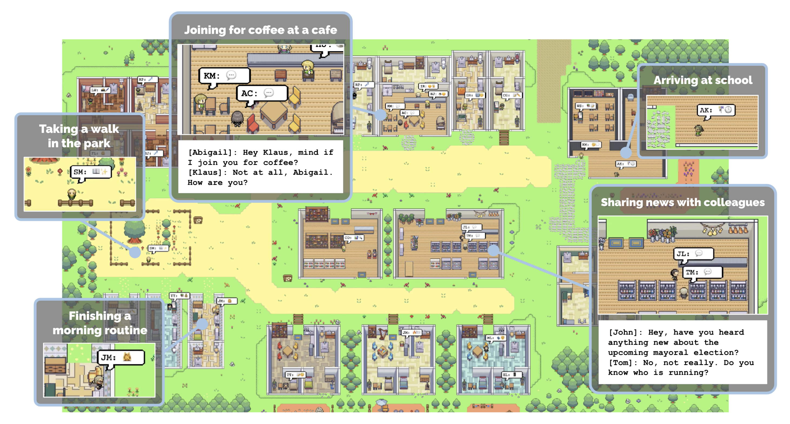

# Smallville

Smallville is a modernized local fork of the Generative Agents demo from Park et al., UIST 2023. It keeps the original Reverie persona simulation engine and Smallville map assets, and wraps them with a cleaner FastAPI backend and React/Phaser frontend.

The default experience is a bundled replay demo that runs without paying for an LLM call. Configure an OpenAI-compatible provider when you want to run fresh Reverie simulations.



## What Is Included

- `backend/` - FastAPI app, JSON API, static map/character assets.
- `frontend/` - React + Vite client with Phaser map rendering.
- `reverie/` - original generative agent simulation engine.
- `data/` - base simulations and bundled compressed replay data.
- `scripts/generate_utils.py` - generates Reverie runtime config from `.env`.

The old Django environment server and shell startup scripts have been removed. Run the backend and frontend with standard Python and Node commands.

## Requirements

- Python 3.10+
- Node.js 18+
- An OpenAI-compatible `/v1` chat completions endpoint for live simulations

## Configure LLM

Create a local `.env` file:

```bash
cp .env.example .env
```

The included provider template is:

```dotenv
LLM_BASE_URL=http://112.5.167.211:58788/v1
LLM_API_KEY=sk-placeholder
LLM_MODEL=gpt5.5
LLM_COMPLETION_MODEL=
LLM_DISABLE_EMBEDDINGS=1
LLM_EMBEDDING_MODEL=text-embedding-ada-002
KEY_OWNER=local
DEBUG=True
```

Replace `LLM_API_KEY` with your own key. Do not commit real keys.

Generate Reverie's local runtime config:

```bash
python3 scripts/generate_utils.py
```

This writes `reverie/backend_server/utils.py`, which is ignored by Git.

## Install

Backend:

```bash
python3 -m venv .venv
source .venv/bin/activate
pip install -r requirements.txt
```

Frontend:

```bash
cd frontend
npm install
```

## Run The Bundled Demo

Build the React app and serve it from FastAPI:

```bash
cd frontend
npm run build
cd ..
uvicorn backend.app.main:app --host 127.0.0.1 --port 8000
```

Open:

```text
http://127.0.0.1:8000/demo/July1_the_ville_isabella_maria_klaus-step-3-20/1
```

The map supports drag-to-pan, mouse-wheel zoom, `+` / `-`, `Fit`, and `Agents` camera controls.

## Development Mode

Terminal 1:

```bash
uvicorn backend.app.main:app --reload --host 127.0.0.1 --port 8000
```

Terminal 2:

```bash
cd frontend
npm run dev
```

Open `http://127.0.0.1:5173`. Vite proxies `/api` and `/static` to FastAPI.

## Run A Live Reverie Simulation

Live simulation still uses the original interactive Reverie CLI. Start the FastAPI backend first, then run:

```bash
cd reverie/backend_server
python reverie.py
```

At the prompts, use a base simulation such as:

```text
base_the_ville_isabella_maria_klaus
```

Then choose a new simulation code, open `http://127.0.0.1:5173/` or `http://127.0.0.1:8000/`, and drive simulation steps from the CLI:

```text
run 10
```

Use `fin` to save or `exit` to quit without saving.

## API

- `GET /api/health` - backend health check.
- `GET /api/config/llm` - redacted LLM runtime status.
- `GET /api/demos` - bundled compressed demos.
- `GET /api/demo/{sim_code}/{step}` - replay data for the React client.
- `GET /api/simulation/status` - currently running live simulation.
- `POST /api/environment/process` - frontend environment state for Reverie.
- `POST /api/environment/update` - movement output from Reverie.
- `GET /api/persona/{sim_code}/{step}/{persona_name}` - persona memory and scratch state.

## Verification

```bash
python -m pytest backend/tests
python -m compileall backend/app scripts reverie/backend_server
python scripts/smoke_reverie.py
cd frontend && npm run build
```

For visual verification, run the backend and open the bundled demo. The default camera should show a comfortable area around active agents, and the `Fit` button should show the full map.

## Storage

- `data/storage/base_the_ville_isabella_maria_klaus` - 3-agent base simulation.
- `data/storage/base_the_ville_n25` - 25-agent base simulation.
- `data/compressed_storage/July1_the_ville_isabella_maria_klaus-step-3-20` - bundled replay demo.
- `data/temp_storage` - local runtime handoff files, ignored by Git.

## Attribution

This project is based on [joonspk-research/generative_agents](https://github.com/joonspk-research/generative_agents), the codebase behind "Generative Agents: Interactive Simulacra of Human Behavior" (Park et al., UIST 2023).

If you use the original simulation engine or assets, cite the paper:

```bibtex
@inproceedings{Park2023GenerativeAgents,
  author = {Park, Joon Sung and O'Brien, Joseph C. and Cai, Carrie J. and Morris, Meredith Ringel Morris and Liang, Percy and Bernstein, Michael S.},
  title = {Generative Agents: Interactive Simulacra of Human Behavior},
  year = {2023},
  publisher = {Association for Computing Machinery},
  booktitle = {In the 36th Annual ACM Symposium on User Interface Software and Technology (UIST '23)}
}
```

Please also respect the licenses and attribution requirements of the included pixel-art assets.
